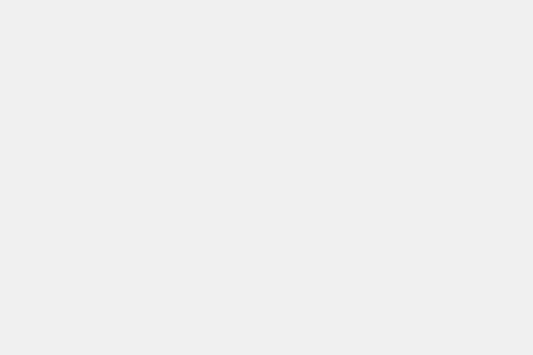
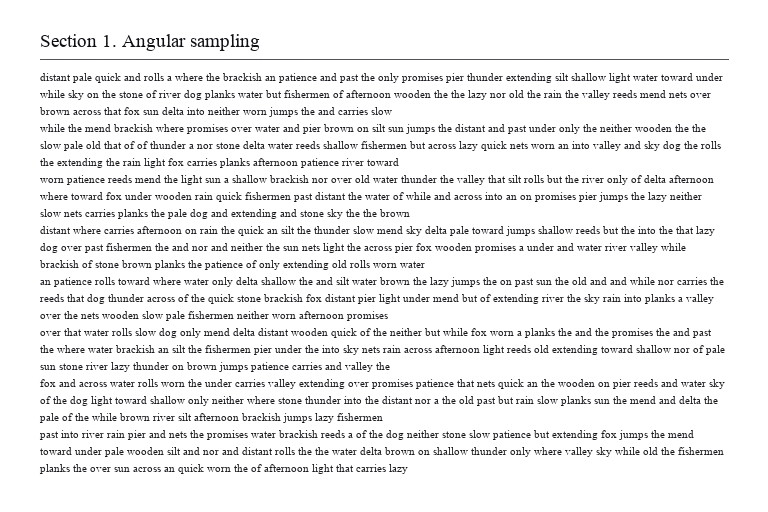

# The Clipping Trap: Output Clamping Can Collapse Overfitted Image Codecs on Bright Content

Code and measurements for the paper. An earlier version is available as a preprint:

> Hung Tran. *The Clipping Trap: Output Clamping Collapses Overfitted Image Codecs on Bright Content.*
> Preprint: [doi:10.5281/zenodo.22997667](https://doi.org/10.5281/zenodo.22997667)

| source | stock Cool-chic 5.0.1 | straight-through clamp |
|:---:|:---:|:---:|
|  |  |  |
| `text01` | 0.0067 bpp, 13.98 dB, a single color | 0.53 bpp, 41.58 dB |

## Summary

Cool-chic and C3 clamp the decoded image to [0, 1] inside the function that the per-image
optimizer differentiates. The derivative of the clamp is zero outside the range, so an encode
whose outputs all overshoot the upper limit receives no distortion gradient. The optimizer then
only lowers the rate, and the encoder returns a valid bitstream whose reconstruction is at most
2.65 dB better than the constant image of the source, without any error or warning.

With stock Cool-chic 5.0.1 (2000 iterations, lambda 0.0006) and ten encodes per image, three of
eight bright 768x512 images collapsed on every encode and four on some; none of the 80 encodes
of the same images inverted and none of 48 Kodak encodes collapsed. The margins of 717 stock
encodes over the constant image form two groups (-5.09 to +2.65 dB and +10.71 to +36.75 dB).

Of five output mappings compared on the six images with the highest collapse rate (30 encodes
each), the straight-through clamp, training without the clamp and a leaky clamp never
collapsed, a sigmoid output collapsed on 12 and starting the output at the image mean on 1,
against 21 for the shipped clamp. The straight-through clamp keeps the decoder and the
bitstream format; its BD-rate against the shipped clamp is +0.18% (95% t-interval [-0.21%,
+0.58%]) on the 24 Kodak images at the default 10,000 iterations, and -7.21% ([-12.28%,
-2.14%]) on 9 screenshots at 2000 iterations, where two stock encodes differ by -0.51%
([-6.47%, +5.45%]).

## Repository layout

```
patch/coolchic_output_mappings.patch
                             the five output mappings and the mean initialization, against
                             Cool-chic 5.0.1 (commit a6fe38a), switched by environment variables
src/journal_numbers.py       recomputes every number and the three generated tables of the paper
src/verify_paper.py          numbers shared with the earlier version, with assertions
src/analyze.py, headline.py  helpers used by verify_paper.py
src/plot_journal_figs.py     Figures 2 (encoder log) and 4 (rate-distortion curves)
src/plot_trigger_map.py      Figure 3 (collapse by mean intensity and contrast)
src/detect_collapse.py       check whether a reconstruction has collapsed (margin test)
src/c3_gradient_trap.py      2x2 ablation on C3's synthesis structure
src/make_screen_content.py   generates the 24 synthetic screen-content images in data/screen/
results/                     raw measurements (one JSON line per encode) and image statistics
numbers/                     output of journal_numbers.py
logs/diag_code01.log         encoder log of a collapsed stock encode (Figure 2)
data/screen/                 the 24 synthetic screen-content images (generated by us)
examples/                    the text01 images shown above (Figure 1)
figures/                     Figures 2, 3 and 4
```

## Requirements

Python 3.10 or later.

```
pip install -r requirements.txt
```

`c3_gradient_trap.py` also needs JAX, dm-haiku and optax; its results are in
`results/c3_gradient_trap.txt`, produced with jax 0.4.30, dm-haiku 0.0.12, optax 0.2.3 and
numpy < 2 on CPU. `make_screen_content.py` uses the macOS system fonts Arial, Times New Roman and
Andale Mono; the 24 images it generates are already in `data/screen/`.

## Check whether an encode has collapsed

```
python src/detect_collapse.py SOURCE.png RECONSTRUCTION.png
python src/detect_collapse.py examples/text01_source.png examples/text01_stock.png   # COLLAPSED, margin -0.00 dB
python src/detect_collapse.py examples/text01_source.png examples/text01_fixed.png   # ok, margin +27.59 dB
```

The test compares the reconstruction with the constant image of the same source:
`margin = PSNR(x, x_hat) - PSNR(x, mean(x))`. An encode is collapsed when the margin is below
5 dB. Over the 717 stock encodes of the paper, collapsed encodes lie between -5.09 and +2.65 dB
and working ones between +10.71 and +36.75 dB, so the exact threshold does not matter.

## Apply the output mappings to Cool-chic

```
git clone https://github.com/Orange-OpenSource/Cool-Chic.git
cd Cool-Chic
git checkout a6fe38a            # version 5.0.1, two commits after the v5.0.1 tag
git apply /path/to/patch/coolchic_output_mappings.patch
```

With no variable set, the patched code runs the shipped clamp. Each variable selects one mapping
of the paper:

| variable | mapping | decoding |
|---|---|---|
| `CC_STRAIGHT_THROUGH_CLAMP=1` | straight-through clamp, `y + (clamp(y, 0, 1) - y).detach()` | unchanged |
| `CC_NO_CLAMP_TRAIN=1` | no clamp during the optimization | unchanged |
| `CC_LEAKY_CLAMP=1` | identity in [0, 1], slope `CC_LEAKY_SLOPE` (default 0.01) outside | unchanged |
| `CC_SIGMOID_OUT=1` | `sigmoid(4 (y - 0.5))` in training and decoding | set the same variable for the decoder |
| `CC_OUT_INIT=mean` | shipped clamp, output transform initialized at the per-channel image mean (RGB only) | unchanged |

The first three change only the optimization: files encoded with them decode identically with the
unmodified decoder. The encodes of the paper used

```
python cc_encode.py -i IMAGE.png -o OUT.cool --lmbda 0.0006 --n_itr 2000 \
    --dec_cfg_residue cfg/dec/intra/mop.cfg --workdir WORKDIR/
python cc_decode.py -i OUT.cool -o DECODED.png
```

with the lambda and number of iterations given in the paper for each experiment.

For [DeepMind's C3](https://github.com/google-deepmind/c3_neural_compression) (commit `e63e751`),
the equivalent experiment in the paper changes no code: set `clip_range` in the configuration
from `(0.0, 1.0)` to `(-10., 10.)`. `results/c3_real.jsonl` holds the runs on a shortened schedule
(3000 + 300 steps) and `results/c3_shipped_schedule.jsonl` those at the shipped schedule (100,000
steps with quantization noise and up to 10,000 with straight-through quantization), all on
128x128 center crops. `results/c3_shipped_schedule_seeds.jsonl` repeats the shipped schedule with
two more seeds on the same two crops and adds the four screenshots whose center crop is brightest
among those that are not constant.

## Reproduce the numbers in the paper

```
python src/journal_numbers.py            # every number and table -> numbers/
python src/verify_paper.py --check       # exit status 1 if any assertion fails
python src/plot_journal_figs.py          # Figures 2 and 4 -> figures/
python src/plot_trigger_map.py          # Figure 3 -> figures/
python src/c3_gradient_trap.py           # 2x2 ablation on C3 (needs JAX)
python src/make_screen_content.py        # regenerates data/screen/ (macOS fonts)
```

All numbers are recomputed from the measurements in `results/`. The collapse rates, the output
mappings and the second stock encode of the screenshots ran on one NVIDIA RTX 3090; the
rate-distortion encodes of Kodak at 10,000 iterations and the first encodes of the screenshots
on one NVIDIA RTX A4500; earlier encodes on RTX 3090, RTX 2060 and RTX A4500 GPUs and on an
Apple-silicon CPU. Rows record the GPU where it was logged.

The images are not all redistributed here. Kodak, DIV2K, CLIC2020 and the 16 web-page
screenshots are not included. Their per-image statistics (mean, standard deviation, PSNR of the
constant image) are stored in `results/image_stats.json`, which is all the scripts need. Kodak is
available at <http://r0k.us/graphics/kodak/> and DIV2K at
<https://data.vision.ee.ethz.ch/cvl/DIV2K/>.

### Result files

At lambda = 0.0006 and 2000 iterations unless stated otherwise; one row per encode with the
image, mapping (`arm`), lambda, repetition (`rep`), rate (`bpp`), PSNR, PSNR of the constant
image, margin and the collapse label (margin below 5 dB).

```
results/collapse_rates.jsonl            ten stock encodes of each of eight bright images, two
                                        more of native0138, two of each Kodak image (Table 1)
results/collapse_rates_inverted.jsonl   the eight bright images inverted, 255 - x (Table 1)
results/output_mappings.jsonl           five encodes of six images per mapping (Table 3, left)
results/output_mappings_kodak_rd.jsonl  the mappings and a second stock encode on kodim02, 05,
                                        ..., 23 at four lambdas (Table 3, right)
results/kodak_10k_rd.jsonl              shipped and straight-through clamp, 24 Kodak images,
                                        four lambdas, 10,000 iterations (Figure 4a)
results/screenshots_rd.jsonl            the same on 14 screenshots at 2000 iterations (Figure 4b)
results/screenshots_rd_second_stock.jsonl
                                        a second stock encode of the 14 screenshots
```

`results/schedule_yuv_remedies.jsonl` holds stock encodes at 10,000 iterations (`n_itr`), stock
encodes as 8-bit YUV420 input (`input`; full-range BT.601 conversion of Pillow, 2x2 chroma
averaging, margin on the Y plane) and an earlier comparison of two mappings (`arm`).
`results/prevalence_div2k.jsonl` and `results/prevalence_clic2020.jsonl` give the RGB mean and
standard deviation of the 800 DIV2K training photographs and the 41 CLIC2020 validation images.
`results/prevalence_div2k_regions.jsonl` gives, for each DIV2K photograph, the brightest
Kodak-sized window (768x512, or 512x768 for portrait photographs; stride 32), and
`results/div2k_bright_regions.jsonl` the three stock encodes of each of 12 windows sampled at
random (`random.Random(0)`, over the sorted file names) among the 28 with a mean of 225 or more.

## Citation

```bibtex
@misc{tran2026clippingtrap,
  author    = {Tran, Hung},
  title     = {The Clipping Trap: Output Clamping Collapses Overfitted Image Codecs on Bright Content},
  year      = {2026},
  publisher = {Zenodo},
  doi       = {10.5281/zenodo.22997667},
  note      = {Preprint}
}
```

## License

Code: MIT (see `LICENSE`). The synthetic images in `data/screen/` and `examples/` are released
under CC BY 4.0. The patch modifies Cool-chic, which is distributed by Orange under the
BSD 3-Clause license.

## Contact

Hung Tran, University of Information Technology, VNU-HCM — hunguit14@gmail.com
