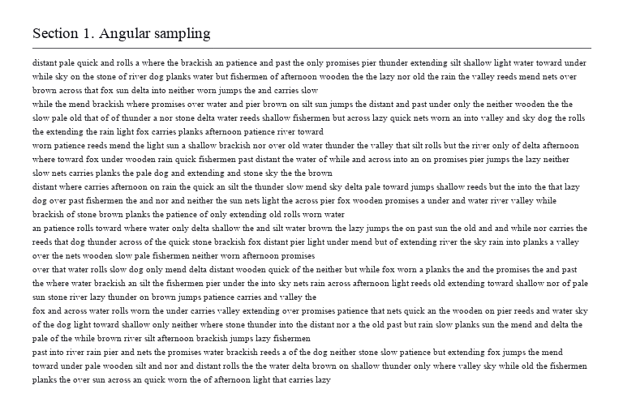

# The Clipping Trap: Output Clamping Collapses Overfitted Image Codecs on Bright Content

Code and measurements for the paper

> Hung Tran. *The Clipping Trap: Output Clamping Collapses Overfitted Image Codecs on Bright Content.*
> Preprint: [doi:10.5281/zenodo.22997667](https://doi.org/10.5281/zenodo.22997667)

| source | stock Cool-chic 5.0.1 | with the fix |
|:---:|:---:|:---:|
|  |  |  |
| `text01` | 0.0067 bpp, 13.98 dB, a single color | 0.53 bpp, 41.58 dB |

## Summary

Cool-chic and C3 clamp the decoded image to [0, 1] inside the function that the per-image
optimizer differentiates. The derivative of the clamp is zero outside the range, so on bright,
low-contrast images the distortion gradient can become exactly zero during encoding. The
optimizer then only reduces the rate, and the encoder returns a valid bitstream whose
reconstruction is no better than a constant image, without any error or warning. PSNR, SSIM,
MS-SSIM and LPIPS score such a reconstruction like the constant image, which on bright, flat
content is already high, so no fixed quality threshold reveals the failure.

A straight-through clamp recovers every collapsed encode we re-ran; initializing the output at
the image mean, the usual remedy for collapse to a constant function, does not (2 of 20 encodes
still collapse, `results/init_ablation.jsonl`). Training without the clamp and a leaky clamp also
recover the five collapsing images (`results/schedule_yuv_remedies.jsonl`). On Kodak, at 2000
iterations, the straight-through clamp changes BD-rate by -0.54% on average (95% t-interval on
the mean: [-1.22%, +0.14%]) and does not change the bitstream format.

The failure survives the default 10,000 iterations (`full0138` 1 of 5, `div127` 3 of 3, `code01`
3 of 3 encodes) and also occurs, less often, on the YUV420 input path (1 of 9 encodes). Images
this bright are rare in the standard sets: one of the 800 DIV2K training photographs and none of
the 41 CLIC2020 validation images reach a mean intensity of 225.

## Repository layout

```
patch/coolchic_ste.patch     the fix, against Cool-chic 5.0.1 (commit a6fe38a)
patch/coolchic_other_remedies.patch
                             two other remedies compared in the Fix section (same commit)
src/detect_collapse.py       check whether a reconstruction has collapsed (margin test)
src/verify_paper.py          recomputes every number in the paper from results/
src/analyze.py, headline.py  helpers used by verify_paper.py
src/plot_trigger_map.py      regenerates Figure 2 into figures/
src/plot_rd_and_log.py       regenerates Figure 3 (Kodak RD curves, encoder log) into figures/
src/c3_gradient_trap.py      2x2 ablation on C3's synthesis structure (Mechanism section)
src/make_screen_content.py   generates the 24 synthetic screen-content images in data/screen/
results/                     raw measurements (one JSON line per encode) and image statistics
logs/diag_code01.log         log of a stock Cool-chic encode during a collapse (Mechanism section)
data/screen/                 the 24 synthetic screen-content images (generated by us)
examples/                    the text01 images shown above
figures/                     Figures 2 and 3
```

## Requirements

Python 3.10 or later.

```
pip install -r requirements.txt
```

`c3_gradient_trap.py` also needs JAX, dm-haiku and optax; the 2x2 results in the paper are the output in
`results/c3_gradient_trap.txt`, produced with jax 0.4.30, dm-haiku 0.0.12, optax 0.2.3 and
numpy < 2 on CPU (other versions give the same collapse but slightly different margins for the
other three arms). `make_screen_content.py` uses the
macOS system fonts Arial, Times New Roman and Andale Mono; the 24 images it generates are
already in `data/screen/`.

## Check whether an encode has collapsed

```
python src/detect_collapse.py SOURCE.png RECONSTRUCTION.png
python src/detect_collapse.py examples/text01_source.png examples/text01_stock.png   # COLLAPSED, margin -0.00 dB
python src/detect_collapse.py examples/text01_source.png examples/text01_fixed.png   # ok, margin +27.59 dB
```

The test compares the reconstruction with the constant image of the same source:
`margin = PSNR(x, x_hat) - PSNR(x, mean(x))`. An encode is collapsed when the margin is below
5 dB. Over the 270 stock encodes in the paper, collapsed encodes lie between -5.09 and +0.79 dB
and working ones between +10.82 and +35.52 dB, so the exact threshold does not matter.

## Apply the fix to Cool-chic

```
git clone https://github.com/Orange-OpenSource/Cool-Chic.git
cd Cool-Chic
git checkout a6fe38a            # version 5.0.1, two commits after the v5.0.1 tag
git apply /path/to/patch/coolchic_ste.patch
```

The patch changes one statement in `coolchic/component/frame.py`: during training, the output
clamp becomes a straight-through clamp (`y + (clamp(y, 0, 1) - y).detach()`); at inference the
clamp is unchanged. Files encoded with the patched encoder decode identically with the
unmodified decoder.

`patch/coolchic_other_remedies.patch` applies to the same commit instead of the fix and adds two
remedies that the paper compares with it, switched on by environment variables:
`CC_NO_CLAMP_TRAIN=1` removes the clamp during the per-image optimization (inference still
clamps), and `CC_LEAKY_CLAMP=1` replaces it with a leaky clamp that is linear with slope
`CC_LEAKY_SLOPE` (default 0.01) outside [0, 1].

For [DeepMind's C3](https://github.com/google-deepmind/c3_neural_compression) (commit `e63e751`),
the equivalent experiment in the paper changes no code: set `clip_range` in the configuration
from `(0.0, 1.0)` to `(-10., 10.)`. `results/c3_real.jsonl` holds the runs on a shortened schedule
(3000 + 300 steps) and `results/c3_shipped_schedule.jsonl` those at the shipped schedule (100,000
steps with quantization noise and up to 10,000 with straight-through quantization), all on
128x128 crops.

## Reproduce the numbers in the paper

```
python src/verify_paper.py            # prints every figure quoted in the paper
python src/verify_paper.py --check    # exit status 1 if any assertion fails
python src/plot_trigger_map.py        # Figure 2
python src/plot_rd_and_log.py         # Figure 3
python src/c3_gradient_trap.py        # 2x2 ablation, Mechanism section (needs JAX)
python src/make_screen_content.py     # regenerates data/screen/ (macOS fonts)
```

All numbers are recomputed from the measurements in `results/`. The encodes themselves were run
with Cool-chic 5.0.1 (`mop` intra configuration, 2000 iterations unless stated otherwise) on
NVIDIA RTX 3090, RTX 2060 and RTX A4500 GPUs and on an Apple-silicon CPU; C3 ran on CPU and, at
its shipped schedule, on an RTX 4090 GPU.

The images are not all redistributed here. Kodak, DIV2K, CLIC2020 and the 16 web-page
screenshots are not included. Their per-image statistics (mean, standard deviation, PSNR of the
constant image) are stored in `results/image_stats.json`, which is all the scripts need. Kodak is
available at <http://r0k.us/graphics/kodak/> and DIV2K at
<https://data.vision.ee.ethz.ch/cvl/DIV2K/>.

`results/schedule_yuv_remedies.jsonl` holds one row per encode for three experiments at
lambda = 0.0006: stock encodes at 10,000 iterations (`n_itr`), stock encodes of the same images
as 8-bit YUV420 input (`input`), and the two remedies of `patch/coolchic_other_remedies.patch`
(`arm`). The YUV420 files were made from the RGB images with the full-range BT.601 conversion of
Pillow and 2x2 chroma averaging, and their margin is computed on the Y plane.
`results/prevalence_div2k.jsonl` and `results/prevalence_clic2020.jsonl` give the RGB mean and
standard deviation of the 800 DIV2K training photographs and the 41 CLIC2020 validation images.

## Citation

```bibtex
@misc{tran2026clippingtrap,
  author    = {Tran, Hung},
  title     = {The Clipping Trap: Output Clamping Collapses Overfitted Image Codecs on Bright Content},
  year      = {2026},
  publisher = {Zenodo},
  doi       = {10.5281/zenodo.22997667},
  note      = {Preprint}
}
```

## License

Code: MIT (see `LICENSE`). The synthetic images in `data/screen/` and `examples/` are released
under CC BY 4.0. The patch modifies Cool-chic, which is distributed by Orange under the
BSD 3-Clause license.

## Contact

Hung Tran, University of Information Technology, VNU-HCM — hunguit14@gmail.com
